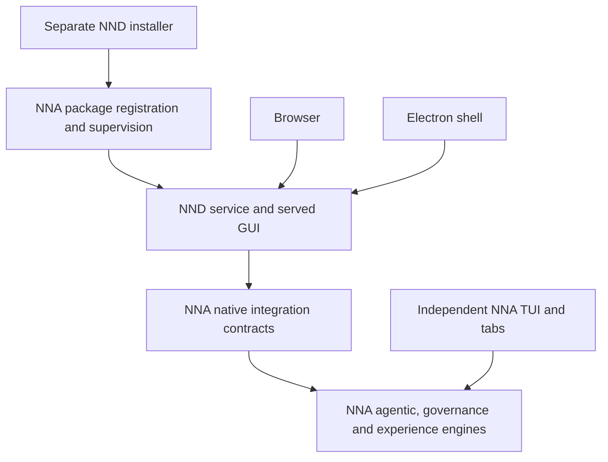

# Architecture audit and migration boundaries

Date: 2026-10-01. Baseline: NND `e6a99dc` / `20261001-41`;
NNA `7363ad1c` / `20261001-6`. Read with [PLAN](../PLAN.md).

Supersession (20261011-6): the dated findings below stand as evidence, but
installer/lifecycle required-work items are superseded by the canonical
dumb-copy shape pinned in [PLAN](../PLAN.md) and
[02 — Installation and lifecycle](02-installation-lifecycle.md) — notably A03's
"staged artifacts / rollback" requirement (the canonical installer accepts
stop-best-effort → copy → build → register/activate, with failure handling
limited to a clear not-installed/degraded state resolved by rerunning the
installer) and any service-start/health-verification ceremony at install time.

This is a planning and architecture audit supported by source inspection. It does
not certify every runtime path. Prior full-suite results remain dated evidence;
this documentation revision does not claim to have rerun installed acceptance.

## Architectural judgment

Keep independent products and native integration. NNA owns agentic behavior,
governance, shared experience state, durable sessions, configuration resolution,
and service lifecycle. Its TUI remains independently useful and retains its tabs.
NND supplies a complete GUI experience through its own installed service and shell.
The shared contract is structured engine behavior, not terminal rendering or tab state.

Retain existing React UI, sync reducers, runtime adapters, review panes, terminal
transport, settings presentation, and native session bridge where their invariants
hold. Replace ownership assumptions at their boundaries. A rewrite is not required.

The diagram shows capability ownership, not a requirement that TUI and NND share
one engine instance or one session collection. Each engine context keeps its owner,
workspace grant, and surface identity. Browser and desktop share NND's collection.

## Non-negotiable boundaries

| State or action | Owner and required behavior |
|---|---|
| Agent turn and tool effects | NNA governs admission, review, cancellation, receipts, and recovery |
| TUI tabs and TUI sessions | NNA TUI; never projected into NND as its navigation model |
| NND sessions | NNA stores engine records with NND surface ownership; NND owns presentation and navigation |
| NNA settings | Native schema, validation, persistence, effective-value resolution and application belong to NNA |
| NND preferences | NND stores theme/layout/drafts; cannot masquerade as engine settings |
| Permission mode | Native session policy; Default resolves to Auto-review; Unattended retains review and denies unresolved escalations |
| Service lifetime | NNA supervision; closing a window is not a stop-service request |
| Provider secrets | NNA secret broker; GUI has credential operations and redacted state, never secret readback |
| Authenticated identity | NNA-approved local operator/package contract; browser headers cannot manufacture entitlement |
| Phase, context, usage and evidence | Native projections with explicit unknown, failure, freshness and retention semantics |
| Operator file/Git/terminal actions | Explicit authenticated user intent with workspace scope; distinguish from model-originated effects |
| Model-originated companion operations | Native reviewed authority and scoped execution capability; GUI route availability cannot bypass NNA |
| Browser guest | Untrusted content; no implicit shell, provider, filesystem or governance authority |

Resolve the old NOTE 17 statement that every write is a governed NNA request by
specifying both actor paths. Do not silently label direct editor saves as agent
effects or allow agent calls to reuse an unrestricted human route. L/F work must
record which operator actions require native admission and how each grant is checked.

## Confirmed findings and consequences

Paths are relative to the named repository; NND `server/` means
`packages/web/src/server/`. Each finding names a concrete failure scenario.
Recommendations are work, not claims of an implemented repair.

| ID | Evidence and classification | Then what? | Required work |
|---|---|---|---|
| A01 | Architectural gap: NNA `src/nnd-package.js` writes registration; NND `server/harness/nna-local.ts` spawns/kills NNA; Electron `main.mjs` disposes its server | Exit Electron and the browser service and GUI engine disappear; background work cannot rely on a resident service | L lifecycle inversion and independent process lifetime |
| A02 | Configuration defect: NND `server/index.ts` attach mode supplies a fixed principal; NNA `src/integration-principal.js` rejects envelopes older than five minutes | Attach initially works, then requests fail as `principal_stale` | L native authenticated refresh; six-minute clock-injection reproduction confirmed |
| A03 | Upgrade failure path: `install.ps1` replaces live files before dependency/build success and later registration | Failure leaves new package metadata with old manifest/registration; next launch can fail | L staged artifacts, atomic activation, rollback and migration compatibility |
| A04 | Install identity gap: custom `-NnaInstallRoot` is used for registration; `nna-local.ts` discovers only the default descriptor or PATH | Successful setup can launch the wrong NNA or fail when PATH lacks it | L persist selected installation identity and data root |
| A05 | Native feature gap: small-model `provider-ports.ts` calls `/config/providers` and reads OpenCode auth files; NNA uses `/v1/provider-profiles` and its secret broker | Chat can work while assist/walkthrough generation fails despite configured NNA credentials | C/F migrate all model helpers to native provider/inference contracts |
| A06 | Verification gap: `scripts/release-gates.js` excludes `packages/electron/` and root installers; graph roots exclude Electron | A sealed version can omit changed shipped startup/security code; graph is incomplete as a product map | L/V extend manifest, graph and quality coverage with explicit debt treatment |
| A07 | Acceptance gap: `scripts/nna-source-smoke.mjs` imports source and creates the app in process | Green source integration cannot prove installation, auth listener, shell, upgrade or browser journeys | V disposable installed-artifact matrix |
| A08 | Architectural gap: native NNA host loads one manifest workspace; directory headers cannot change its grant | A selected NND project/worktree is not proof that an engine runs there | F authenticated workspace admission; reject mismatches until supported |
| A09 | Coverage gap: native frames replay only an in-memory suffix; bounded Activity is not a complete journal feed | Expired cursor/restart may restore state without a full event history | F explicit gap/snapshot semantics and separate durable evidence contract |
| A10 | Document contradiction: old W-20/W-32/W-86 and notes prescribe auto-accept; native mode contract retains mandatory review | A future agent could restore a bypass while claiming parity | Native policy amendments supersede reference controls |
| A11 | Document contradiction: mock-only claims, obsolete slices and copied-component instructions coexist with native source | Agents may rebuild finished features, copy upstream code or count mock success as native acceptance | Authority banners, execution spine and W-id traceability |
| A12 | Native chat gap: NNA `src/nnd-harness-routes.js` filters submitted parts to text; NND `sync/session-actions.ts` submits file parts | An attachment can appear sent while its content/reference never reaches execution | F native attachment admission and rejection of unsupported parts |
| A13 | Native operation gap: native session route excludes fork/revert/unrevert and accepts only title/time PATCH; NND clients invoke these operations and BTW metadata patches | Visible chat operations fail against NNA although mock consumers work | F explicit native operations and durable lineage contracts |
| A14 | Settings gap: NND MCP editor writes OpenCode configuration; native MCP inventory is a separate read-only view — RESOLVED BY C5 at 20261010-8: the legacy writer is mock-only and the native editor rides the scoped native MCP API (the historical finding text is retained as written) | Successful save need not configure NNA | C native MCP read/write/application and migration |
| A15 | Configuration gap: NNA integration startup calls `resolveManifest` directly rather than the layered startup resolver | Trusted project settings and source provenance can differ from the independent TUI | C common native resolution with surface-specific context and scopes |

Remote-only startup also currently waits for local server/NNA in Electron.
That remains a remote-design gap, outside the first same-computer deployment gate.
Track it before declaring remote-client support complete.

## Configuration and feature evolution

Version the integration schema and negotiate capabilities separately from product
version. Record required versus optional features. Unknown required schema versions
must fail with actionable compatibility guidance. Optional features may explain
unavailability; missing required features block release.

All configurable settings means an exhaustive field inventory from NNA authorities,
including nested fields and non-manifest stores. A generated form over a partial
schema is insufficient. Distinguish editable policy, immutable session authority,
secret references, startup environment and derived diagnostics. C packages define
the inventory and coverage gate; missing native setters are NNA work.

All chat and visibility features means W-id subfeatures receive native acceptance
rows. Redacted tool evidence is legitimate; fabricated tool output is not. Reasoning
renderers display only information NNA deliberately exposes. Private reasoning
or secret payloads are not required for interface completeness.

## Planning corpus disposition

Every numbered reference remains available for UX detail. Its header identifies
it as reference material. The following amendments control executable work.

| Reference | Keep | Amend through guide |
|---|---|---|
| 00 index | Provenance and domain map | PLAN authority and scoped parity baseline |
| 01 architecture/shell | UI layout, adapters, boot UX | L service-owned boot; F two NND doors; separate TUI |
| 02 harness | P-ports and wire fixtures as consumer inventory | L native negotiation; F operation mapping, no forced OpenCode semantics |
| 03 server/API | Route and journey inventory | C native config; L ownership; F companion action scope |
| 04 sync | Replica, ordering, idempotency and recovery | F epochs, explicit gaps, durable records and bounded views |
| 05 chat | Composer, timeline, sidebar, questions, visibility | F real native parts, attachments, steering, fork/revert and reviewer semantics |
| 06 review | Files, diff, Git, worktrees, comments, plans, integrations | F actor/workspace authority and changed-file provenance |
| 07 terminal | ConPTY, rendering, replay, selection, controls | L/F service lifetime and operator versus agent execution |
| 08 remote/security | Local auth, credential isolation, threat cases | L local admission required; remote deployment deferred |
| 09 Electron | Window/IPC/guest/tray/native affordances | L attach instead of ownership; V installed artifact and shipped file coverage |
| 10 VS Code | Reference archive | Post-MVP surface, no new implementation prerequisite |
| 11 mobile | Reference archive | Native mobile post-MVP; browser responsive usability remains required |
| 12 autonomy | Goals, queue, scheduling, comparison | F governance, durable occurrence identity, service lifetime, no auto-accept |
| 13 preview | Discovery, annotation, capture, walkthrough | F native model helpers; explicit browser versus Electron capabilities |
| 14 settings/theme | Preferences, locale, shortcuts | C all NNA settings in addition to NND preferences |
| 15 knowledge | Notes, memory, skills, MCP and context | C/F native discovery/configuration/delivery, provenance and exact scope |

## Build-document disposition

| Documents | Revised use |
|---|---|
| PLAN | Canonical execution entry point, replaces phase chronology |
| GUI-PLAN | Execution-guide navigation; old A-G schedule is historical |
| SECTION-1 | Stable W inventory; native-policy amendments precede reference details |
| SECTION-2 | Dated 2026-09-22 snapshot, never a current-state claim |
| SECTION-3 | Historical reference-path map; no permission to transplant code |
| SECTION-4 | Historical slice evidence, superseded execution order |
| DECISIONS | Preserve decisions with current product-direction amendment at top |
| PROGRESS/EVALUATION | Append evidence; old passes never silently become installed acceptance |
| NOTES 01-09, 12-15 | Historical subsystem extraction; corresponding reference amendments above apply |
| NOTE 16 | Preserve baseline/delta provenance; native bridge exists, old mock-replacement ordering superseded |
| NOTE 17 | Retain experience; resolve actor authority, terminal lifetime and memory ownership through L/C/F |
| NOTE 18 | Retain native contract evidence; remaining features and recovery belong in F |
| NOTE 19 | Transitional managed-child record; replace deployment through L |
| NOTE 20 | Preserve managed SSH evidence; remote deployment outside MVP |
| NOTES 21-23 | Preserve push/routing/notifications; installed browser acceptance and service lifetime remain V gates |
| p12b review/session notes | Historical UI work; revalidate native wiring instead of repeating mock slices |
| ADR 0020 | Amend service/surface boundary and independent TUI; paired NNA ADR alignment is an L dependency |
| ADR 0016/0017, registries/reports | Preserve standards; extend coverage deliberately, never declare omitted files checked |

Do not rewrite dated evidence to describe unimplemented behavior. A banner can
retire an instruction, but cannot close a work package. Record exact replacement
paths and evidence as each L/C/F/V package lands.
